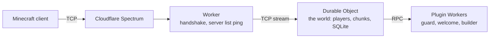

# workercraft

**A Minecraft server with no server.** The Java Edition protocol, written from
scratch in TypeScript, running on Cloudflare Workers. No JVM, no container, no
VM: a Worker takes the TCP connection and a Durable Object is the world.

## Paper wake lobby (this fork)

This fork uses the tiny Workercraft world as a temporary Java lobby while a
Paper backend starts. A real join calls an authenticated wake endpoint, then
the player is transferred to Paper as soon as that endpoint reports it ready.
Server-list pings never wake Paper.

Set these Worker secrets before deploying:

```sh
npx wrangler secret put WAKE_URL       # https://<tunnel-host>/wake
npx wrangler secret put WAKE_TOKEN     # same random value as the VM gateway
npx wrangler deploy --var BACKEND_HOST:<paper-host>
```

`BACKEND_HOST` is your Paper server's public address and is passed at deploy time. `BACKEND_PORT` lives in `wrangler.jsonc`. Every setting is in `.env.example`. The companion
gateway is in the parent Minecraft deployment at `deploy/wake-gateway.ts`; it
must be reachable only through a Cloudflare Tunnel. The player transfers only
after its RCON readiness check succeeds, rather than when Java merely opens a
port.

A demo world runs at **`mc.bad.engineering`** (Java Edition 26.3). It is a
public creative world that checks nobody's account, so expect a mess, and it
may not stay up.

## How it works

Workers got [inbound TCP](https://developers.cloudflare.com/changelog/post/2026-11-19-inbound-tcp/)
in November 2026. That was the missing piece: a Minecraft client speaks a raw
TCP protocol, not HTTP.



- **A Worker** accepts the connection and answers server list pings by itself,
  so the server shows as online without anything else running.
- **A Durable Object is the world.** It holds every player's connection, so
  broadcasting is a loop over a `Map`, and it is single-threaded, like a
  Minecraft server's main thread. Changed blocks are rows in its SQLite
  storage; an untouched chunk costs nothing.
- **Plugins are Workers.** Each hook (`onJoin`, `onBlockBreak`, ...) is an RPC
  call over a service binding, and the plugin gets a handle back to the world.
- **The version data is not copied by hand.** Packet ids, registries, tags,
  block states and collision are generated from Mojang's own server jar, and
  the test suite decodes the server's output with Mojang's own packet code.
  The rules of the game (how a stair turns a corner, which way a door hinges)
  are written here, block class by block class.

## Status

Speaks Minecraft **26.3** (protocol 777). Offline mode, creative, flat world.
It can also be built for 26.1.x (protocol 775); see [Tests](#tests).

Works, and covered by the tests:

- Server list ping, login, configuration, joining
- Chunks, with edits and player positions persisted across restarts
- Seeing other players join, move, sneak, swing and leave
- Chat, commands (`/list`, `/tp`), join and leave messages
- Breaking and placing blocks, with a reach check
- Blocks placed the way the game places them: logs along the clicked face,
  stairs and slabs by where the click landed, torches and signs on walls,
  doors and beds as two blocks, fences, panes, walls and stairs joining up
- Torches, flowers and the like falling off when their block is broken
- Doors, trapdoors, fence gates, levers and buttons, with their sounds
- Signs: the editor opens, the text is stored and shown to everyone. Dyes,
  glow ink and honeycomb work on them
- Chests, beds, banners and other block entities being drawn
- The item in a player's hand, and their armour, shown to other players
- Inventories remembered between sessions
- Dropping items, seeing them on the ground, picking them up
- Middle-click pick block
- Plugins as separate Workers, including cancelling events

Written but not covered by a test: sprinting shown to other players and
`/spawn`. Skins are checked by hand only.

Not there:

- Survival, mobs, redstone, world generation, a lighting engine.
- Account verification (see [Offline mode](#offline-mode-and-skins)).
- Chests, furnaces and the other blocks with a screen do not open.
- Water and lava can be placed but do not flow, and an empty bucket does not
  pick them up.
- Levers and buttons move and click but power nothing.
- What a block may be attached to is not checked when it is placed, so a
  torch can be put on a fence post or a pane. Double chests do not join.
- An item keeps only its type and count, so enchantments and names are lost.
  Items on the ground are not saved.

How far it has been tried with the real game: two people have been on the
deployed 26.3 server at once, joining, chatting and building with a plugin
command. Placing blocks, signs and doors were tried by hand on the 26.1 build;
on 26.3 they are covered by the conformance test, which proves the game can
read what the server sends, not that it then does the right thing with it.

## Run it

Developed on Node 26. Generating the version data needs a JDK, version 25 or
newer (`java`, `javac`, `jar` and `javap` on the path).

```sh
npm install
npm run gen     # once: downloads Mojang's server jar and extracts the version data
npm run dev
```

Open Minecraft 26.3, add a server with the address `localhost`, join.
`http://localhost:8787` returns who is online as JSON.

`npm run gen` exists because this repository contains no Mojang code or data.
It downloads the official server jar into `.cache/`, runs the jar's own data
generator, asks its classes a few questions (`scripts/Probe.java`) and writes
`src/generated/v777.json`. The game server itself is never started.

## Plugins

```ts
// plugins/guard/index.ts
import { definePlugin, type BlockEvent, type Server } from "../../sdk/plugin";

async function guard({ player, x, z }: BlockEvent, server: Server) {
	if (Math.abs(x) > 6 || Math.abs(z) > 6) return;
	await server.message(player.name, { text: "Spawn is protected.", color: "red" });
	return { cancel: true };
}

export default definePlugin({ onBlockBreak: guard, onBlockPlace: guard });
```

A plugin is a Worker with its own `wrangler.jsonc`. To load it, bind it to the
world under a name starting with `PLUGIN_` (see `services` in `wrangler.jsonc`)
and add its config to the `dev` script. Hooks and the server handle are
documented in `src/plugins/api.ts`.

Included: `guard` (spawn protection), `welcome` (greeting, `/hello`) and
`builder` (`/sphere <block> [radius]`).

## Deploy

Inbound TCP reaches a Worker through Spectrum, which needs a Pro or Business
zone (or Spectrum Enterprise). Those plans allow one Worker application on one
TCP port per zone.

The Worker has to be in the same account as the zone. If `wrangler whoami`
lists more than one account, set `CLOUDFLARE_ACCOUNT_ID` first.

1. `npm run deploy` (deploys the plugins, then the world).
2. In the dashboard: Spectrum → Create an Application → type **Workers (tcp)**,
   a subdomain such as `mc`, edge port `25565`, origin Worker `workercraft`.
   Or through the API, with a token that has Zone Settings: Edit, where the
   origin is the Worker's tag from `GET /accounts/<account>/workers/scripts`:

   ```sh
   curl "https://api.cloudflare.com/client/v4/zones/$ZONE_ID/spectrum/apps" \
     --header "Authorization: Bearer $CLOUDFLARE_API_TOKEN" \
     --json '{"dns":{"type":"CNAME","name":"mc.example.com"},"protocol":"tcp/25565","traffic_type":"worker","origin_worker_id":"<WORKER_TAG>"}'
   ```
3. Join `mc.<your domain>`.

Things worth knowing:

- The deployed world starts empty: the world built under `wrangler dev` stays
  in `.wrangler/state` on your machine.
- After a deploy the world keeps running the old code for a couple of minutes
  while players are connected, then restarts and disconnects them.
- `wrangler tail` does not show what the world logs. The Workers Observability
  query API does.

Open questions for production, none of them answered by the beta docs yet:

- How CPU time is limited for a Durable Object holding a TCP stream open for
  hours. Locally, 100 players all moving cost a few CPU-seconds per 10 seconds.
- How long such a connection may stay open.
- What Spectrum charges for traffic on Pro and Business.

## Offline mode and skins

The server does not verify accounts, so anyone can join under any name. That
is fine for a demo and wrong for a server people care about. Verifying
accounts needs the protocol's encryption step (RSA key exchange, then
AES-CFB8), which is the next thing to build.

Skins are looked up by player name: from Mojang's public profile API, and,
because Mojang turns away requests coming from Cloudflare's network, from
playerdb.co and then minetools.eu when Mojang gives no answer. That sends the
names of the players who join to those services. The skin itself is signed by
Mojang and the game checks the signature, so none of them can make one up. Set
the `SKINS` variable to `off` to look nothing up.

## Tests

Both suites run against a server that is already running, and both build
things in its world, at a random spot far from spawn.

```sh
npm run dev          # in one terminal
npm test             # in another
```

`npm test` is a conformance test judged by the game itself. A small Java
program (`test/conformance/Conformance.java`) joins like a client and decodes
everything the server sends with the packet code in Mojang's server jar, the
same code the real game runs. It fails on a packet the game could not read or
one with bytes left over, builds the registries from the configuration packets
the way the game does, and reads chunks with the game's chunk reader. It uses
the jar that `npm run gen` downloaded. `JOIN_ONLY=1 npm test` only joins and
looks, without building.

`npm run test:bots` is the older, larger suite: mineflayer bots that play
through most features. Their library stops at Minecraft 26.1, so the server
has to be built for that version first: `npm run gen -- 26.1.2`, then
`npm run dev:26.1`. Its checks have time limits and fail at random on a busy
machine.

## Other game versions

```sh
npm run gen -- 26.3    # any release; writes src/generated/v<protocol>.json
```

`tsconfig.json` says which of those files the server is built with
(`#version-data`); `tsconfig.26.1.json` is the same build for 26.1.x.

A newer version usually also changes the layout of some packets. Those live in
`src/protocol/packets.ts`, `src/world/session.ts` and `src/world/chunks.ts`,
where each difference between 26.1 and 26.3 is marked with `BEFORE_26_3`. The
conformance test, compiled against the new jar, says which packets the new
game can no longer read.

A world does not depend on the version: blocks are stored by name, so one
saved under 26.1 opens under 26.3. A block the running version does not have
shows as air and is kept in storage.

## Layout

| Path | What |
|---|---|
| `src/index.ts` | The Worker: handshake, server list ping, pipe to the world |
| `src/world/world.ts` | The Durable Object: players, movement, chat, blocks |
| `src/world/session.ts` | One connection: protocol phases and packet parsing |
| `src/world/chunks.ts` | Block storage and the chunk packet |
| `src/world/blockstates.ts` | Block state ids to properties and back |
| `src/world/building.ts` | Placement rules, neighbour reactions, right-clicks, signs |
| `src/world/items.ts` | Physics of dropped items |
| `src/world/skins.ts` | Offline UUIDs and the skin lookup |
| `src/protocol/` | Packet builders and the version data |
| `src/net/` | Varints, framing, NBT |
| `src/plugins/`, `sdk/` | Plugin API, host and SDK |
| `plugins/` | Example plugin Workers |
| `scripts/gen-data.mjs`, `scripts/Probe.java` | Generate version data from the server jar |
| `test/conformance/` | The conformance test, judged by Mojang's packet code |
| `test/e2e.mjs` | The bot suite (26.1 build only) |

## License

[MIT](LICENSE). Not affiliated with Mojang or Microsoft. "Minecraft" is a
trademark of Mojang Synergies AB.
